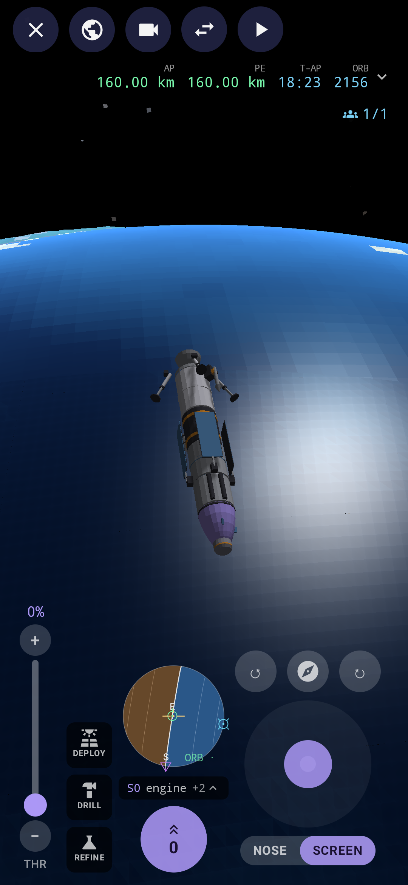
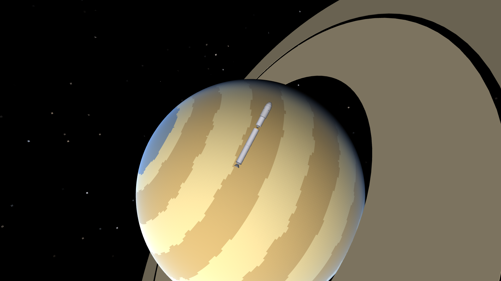
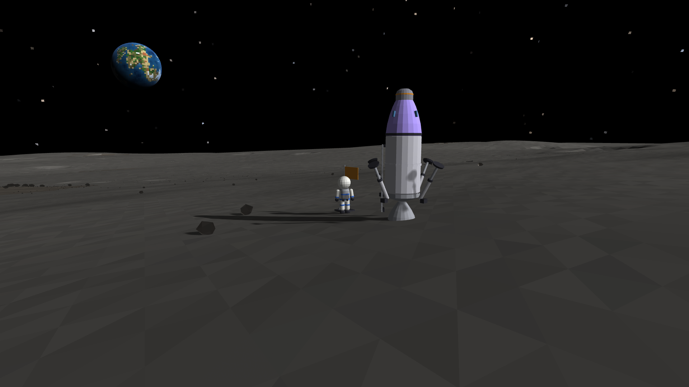
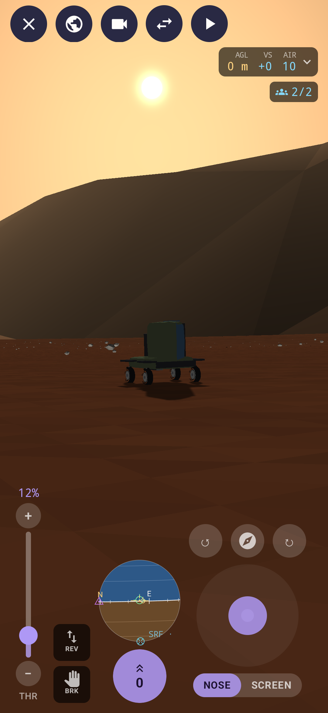
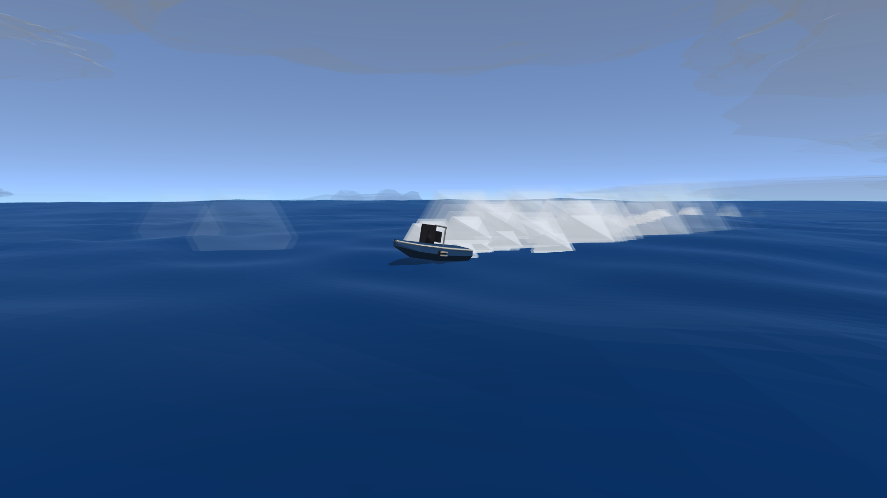
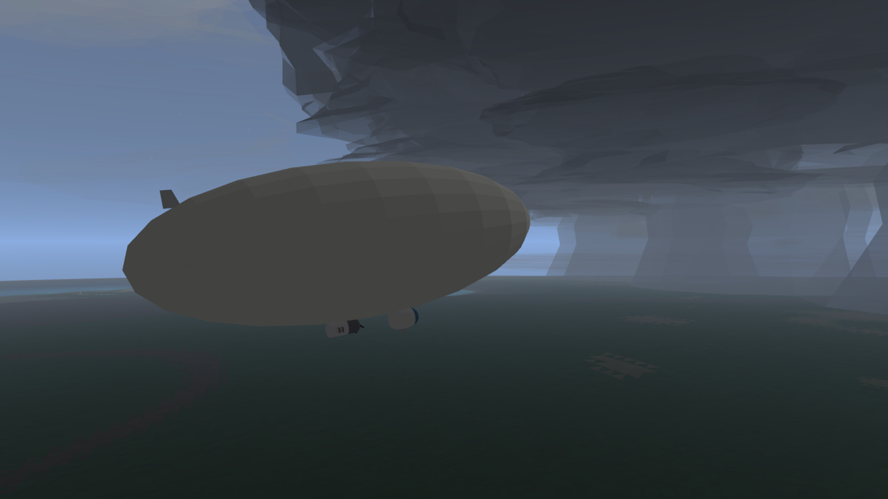

# Apogee

Apogee is a physics sim for Android 8.1 or newer, Linux, Windows and browsers. Build rovers, planes, rockets, boats, submarines, helicopters and airships, then take them across the land, sea and solar system.

Free play gives you the parts and stock craft from the start. In career mode you earn new parts through feats as you explore. You can build bases on land, at sea or in the air, and host a world to explore with friends. The browser version is solo only.

It's ready to play and test. Build things, break things and let me know how it goes in #apogee [on my discord](https://discord.gg/9Wun47jGC6), or open an issue here.

Enjoy!
Dan

  

  

---

## What's in it

- A solar system with different gravity, air, weather and ground on each world. Terra has a launch complex, airfield, harbour and coast. You can land on any world with solid ground.
- Vehicle Assembly with symmetry, staging, action groups and saved assemblies. The stats card shows Δv, thrust, lift, buoyancy and how high the craft can go.
- Rockets with planned burns and autopilots, planes with flaps and approach cues, rovers with suspension, hitches and winches, and helicopters, drones, balloons and airships.
- Boats with sails, motors and water jets, submarines with ballast and sonar, and decks you can carry vehicles on. Flat Top has a catapult and arresting wires.
- Waves, tides, currents and underwater canyons and vents. Launch at the Roaring Sea with Wild weather for big seas.
- Hurricanes, tornadoes, waterspouts, tsunamis, rogue waves, quakes, dust storms, blizzards, hail, lightning and volcanic ash. Set Extreme for frequent events or Wild for occasional ones.
- Bases with pads, power and industry that turns ore and water into propellant.
- Crew who fly, walk, climb ladders, swim, dive, plant flags and rescue each other. Suits limit how deep they can dive.
- Save points and reverting to launch in your own world.
- Hosting, joining and dedicated servers for shared worlds.

Auto land is in the stability assist menu for anything that flies.

---

## Installing

Add [my F-Droid repo](https://hunke.ws/fdroid/repo?fingerprint=80438B253C257BCCE05CDCB9E3AC9B6174C2250659962B14FCBE7F32FD42D53E), then search for Apogee. F-Droid offers new versions as updates. You can also get an APK from [Releases](https://github.com/roge-rm/Apogee/releases).

### Linux

On Debian 13 (Trixie), Ubuntu 24.04 and newer, and Raspberry Pi OS (64-bit), the easiest way is my apt repo, so it updates with the rest of the system. Add it once:

```
sudo curl -fsSLo /etc/apt/keyrings/hunke.asc https://hunke.ws/apt/hunke.asc
echo "deb [signed-by=/etc/apt/keyrings/hunke.asc] https://hunke.ws/apt stable main" | sudo tee /etc/apt/sources.list.d/hunke.list
sudo apt update
```

Then `sudo apt install apogee`. It brings Java 21 with it.

Or from the [Releases](https://github.com/roge-rm/Apogee/releases) page:

- Debian and Raspberry Pi OS: the `.deb` for your machine, amd64 or arm64. Install it with `sudo apt install ./apogee_*.deb`.
- Other distributions (Ubuntu 22.04 and newer, Fedora, Arch, the Steam Deck): the AppImage, x86_64 or aarch64. It has its own Java, so just make it executable and run it.

It needs OpenGL 3.3. F11 goes full screen.

### Steam Deck

Use the x86_64 AppImage. In Desktop Mode, download it, right-click it and turn on **Is executable** under **Properties › Permissions**. Then add it to Steam with **Add a Non-Steam Game** so it's in your library in Game Mode. It runs full screen there, with the Deck's controls working like any gamepad.

### Windows

Windows 10 or 11, 64-bit. From the [Releases](https://github.com/roge-rm/Apogee/releases) page, run `apogee-*-setup.exe`, or unzip `apogee-*-windows-x64.zip` anywhere and run `Apogee.exe`. They aren't signed, so Windows will warn you: choose **More info** and then **Run anyway**. The first time you host a game, Windows asks whether Java can use the network: allow it on private networks so others can join.

## Using the map

Tap a world, craft, named place or orbit event to inspect it, then choose an action from its card. You can tap anywhere on a visible world, including the one you're orbiting, or tap its label. Overlapping markers offer a choice of objects. Tap empty space or Close to dismiss the card; double-tap an object to focus the view.

Tap your orbit to select a point and see its altitude, speed and countdown. Choose Add burn to open the burn editor, or Warp here to stop shortly before that point. Tapping alone doesn't change your target or add a burn.

## Playing in a browser

You can play it at [hunke.ws/fdroid/play/apogee](https://hunke.ws/fdroid/play/apogee/). It's the same game, solo only, and your universes and craft are kept in the browser. It needs WebGL 2 and WebAssembly GC (Chrome or Edge 119, Firefox 120, Safari 18.2 or newer).

Drag to look around, use the wheel to zoom, and right-drag to pan in the Vehicle Assembly. On a keyboard, here and on the desktop:

| | |
|---|---|
| W S, or up and down | pitch |
| A D, or left and right | yaw, and steering |
| Q E | roll |
| Shift, Ctrl | throttle up and down |
| Z, X | full throttle, and off |
| Space | stage |
| M | the map |
| C | the camera: free, chase, cockpit or locked |
| V | steer by the screen or by the craft's nose |
| T | stability assist |
| R | thrusters |
| B | brakes |
| G | gear and legs |
| F | flaps |
| Esc | back, or the flight menu |

## Playing with a controller

Any gamepad works on Android, on the desktop and in a browser, including a handheld's built-in controls. I laid it out for the Retroid Pocket Mini:

| | |
|---|---|
| Left stick | steer (and walk, on foot) |
| Right stick | look around |
| R2, L2 | throttle up and down, faster the harder you press |
| L1, R1 | roll |
| A | stage (hold it a moment) |
| B | brakes |
| X | stability assist |
| Y | the map |
| D-pad up and down | zoom |
| D-pad left and right | time warp |
| L3 | thrusters |
| R3 | the camera |
| Select | gear and legs |
| Start | the flight menu |

On foot, A jumps, B grabs a ladder, X boards and Select plants a flag. In the water the triggers swim down and up. In the menus, the D-pad moves, A picks and B goes back. You can change any of it in Settings, under Controls. In a browser, press a button first so the page can see the controller.

## Building it

You need JDK 17 or newer, and the Android SDK for the app.

```sh
./gradlew :app:assembleDebug                   # the debug APK, in app/build/outputs/apk/debug/
./gradlew :app:assembleRelease                 # the release APK, in app/build/outputs/apk/release/
./gradlew :shared:wasmJsBrowserDistribution    # the web page, in shared/build/dist/wasmJs/productionExecutable/
./gradlew :desktop:run                          # the desktop version, on this machine
./gradlew :desktop:debAmd64                     # a .deb (debArm64 too)
./gradlew :desktop:appImageAmd64                # an AppImage (appImageArm64 too)
./gradlew :desktop:windowsX64                   # the Windows installer and zip
```

The desktop version needs JDK 21 and CMake. Its packages other than the amd64 `.deb` are cross-built in Docker.

The web page's sound needs [Emscripten](https://emscripten.org) in `~/.local/share/emsdk` (or wherever `EMSDK` says). Without it the page is silent.

The release build is signed with my key, which isn't in the repository, so anywhere else it comes out unsigned.

The tests:

```sh
./gradlew --continue :core:test :net:test :server:test :dedicated:test :shared:testAndroidHostTest
```

Without an Android SDK the app is left out, so the server builds with just a JDK.

Terra uses Earth relief and climate data, with a redesigned Cape harbour. See [terrain sources and attribution](docs/terra-terrain.md). Multiplayer games require matching terrain generations. All players and dedicated servers need the terrain introduced in 0.9.4.

## Running a server

A dedicated server is a persistent world that players join from **Join a Game**. See [dedicated/README.md](dedicated/README.md), with Docker or without.

## How it's laid out

| | |
|---|---|
| `core` | The simulation: the solar system, physics, parts and craft, the sea, weather, bases, crew and the career. Plain Kotlin, no Android. |
| `net` | How clients and servers talk, and a client's prediction of the craft it's flying. |
| `server` | The game server, the same one whether a phone hosts or a dedicated server runs it. |
| `dedicated` | The standalone server, with its admin channel. |
| `web-admin` | The dedicated server's admin page. |
| `shared` | The game itself, for the app and the web page alike: the renderer, the sound, and the flight and builder screens. |
| `app` | The Android app around it. |
| `web` | The synth's build for the web page. |
| `art` | The icon and the tools for the parts' pictures. |

The server runs the world. The app predicts your craft between updates and corrects it to match the server.

## Licence

Apogee is free software under the GNU General Public License, version 3 or later. See [LICENSE](LICENSE).

Copyright © 2026 Dan Hunke.

Disclaimer: I am not a great programmer and this was made using Claude Opus 5.0/5.5
